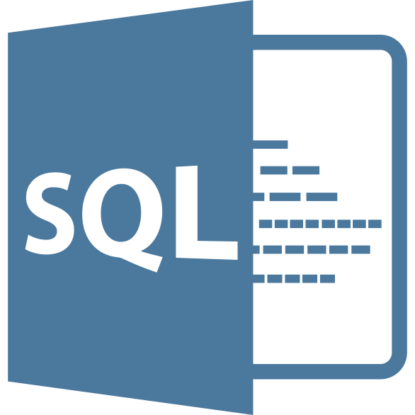

# MySQL Notebooks — Practice Repository

A collection of MySQL lecture notes you can run inside VS Code as **notebooks** using the **SQL Notebook** extension. Each lecture has:

| File | What it is |
|------|------------|
| `Lecture-N.sql` | The lecture's queries — **one query per notebook cell**. Open it with SQL Notebook and run it cell by cell. |
| `readme.md` | Step-by-step explanation of every query: what each clause does, the expected result, common mistakes and "Try it yourself" exercises. |

This guide walks you through installing MySQL, setting up the SQL Notebook extension, connecting to your server, and running the lectures.

---

## Table of Contents

1. [What's in this repo](#whats-in-this-repo)
2. [Prerequisites](#prerequisites)
3. [Step 1 — Install MySQL Server](#step-1--install-mysql-server)
4. [Step 2 — Install the SQL Notebook extension](#step-2--install-the-sql-notebook-extension)
5. [Step 3 — Create a database connection](#step-3--create-a-database-connection)
6. [Step 4 — Open a lecture as a notebook](#step-4--open-a-lecture-as-a-notebook)
7. [Step 5 — Run your first queries (example)](#step-5--run-your-first-queries-example)
8. [Running the lectures](#running-the-lectures)
9. [Useful keyboard shortcuts](#useful-keyboard-shortcuts)
10. [Troubleshooting](#troubleshooting)

---

## What's in this repo

Each lecture lives in its own folder. All lectures work on the same `pal_india` database and its `students` table (plus an `addresses` table from Lecture 4):

| Folder | Topics |
|--------|--------|
| [Lecture 1](Lecture%201/readme.md) | `CREATE DATABASE` / `CREATE TABLE`, `ALTER TABLE` (add / rename / drop / modify columns), `DROP` vs `TRUNCATE`, selecting columns, `WHERE` with AND/OR, `IN` / `NOT IN`, LIMIT/OFFSET, multi-column ORDER BY, aliases, LIKE, `createdAt`/`updateAt` timestamps, transactions |
| [Lecture 2](Lecture%202/readme.md) | Pagination with LIMIT/OFFSET, multi-column sorting, column & table aliases, LIKE wildcards, order of clauses cheat sheet |
| [Lecture 3](Lecture%203/readme.md) | UPDATE, `ON UPDATE CURRENT_TIMESTAMP`, COUNT/SUM/AVG/MIN/MAX, GROUP BY, HAVING, ANY_VALUE, subqueries with IN, AND/OR precedence, BETWEEN, views, `SHOW PROCEDURE STATUS` |
| [Lecture 4](Lecture%204/readme.md) | Managing views, EXPLAIN / EXPLAIN ANALYZE, composite UNIQUE index, `addresses` table with ENUM + foreign key (ON DELETE CASCADE), INNER/LEFT/RIGHT/CROSS joins, full outer join via UNION |

```
Mysql Notes/
├── Lecture 1/
│   ├── Lecture-1.sql      ← open this with SQL Notebook
│   └── readme.md          ← explanation of every query
├── Lecture 2/
│   ├── Lecture-2.sql
│   └── readme.md
├── Lecture 3/
│   ├── Lecture-3.sql
│   └── readme.md
├── Lecture 4/
│   ├── Lecture-4.sql
│   └── readme.md
├── images/
└── readme.md              ← this setup guide
```

> The `Lecture-N.mysql-notebook` files in each folder are the original class recordings from an older tool. You don't need them — the `.sql` files contain the same queries.

**How to study a lecture:** open the lecture's `readme.md` (`Ctrl+Shift+V` for the formatted preview) next to its `.sql` notebook, run one cell, and compare your result with the explanation.

---

## Prerequisites

| Tool | Purpose | Download |
|------|---------|----------|
| **VS Code** | Editor | https://code.visualstudio.com/ |
| **MySQL Server 8.0+** | The database engine the queries run against | https://dev.mysql.com/downloads/mysql/ |
| **SQL Notebook** extension (by *cmoog*) | Opens `.sql` files as notebooks and runs each cell | VS Code Marketplace — see [Step 2](#step-2--install-the-sql-notebook-extension) |

---

## Step 1 — Install MySQL Server

### Windows

1. Download **MySQL Installer for Windows** from https://dev.mysql.com/downloads/installer/
2. Run the installer and choose **Server only** (or **Developer Default** if you also want MySQL Workbench).
3. During configuration:
   - Authentication method: **Use Strong Password Encryption** (default).
   - Set a **root password** — write it down, you'll need it in Step 3.
   - Keep the default port **`3306`**.
   - Tick **Start the MySQL Server at System Startup**.
4. Finish the installer.

### Check that the server is running

Open PowerShell and run:

```powershell
mysql -u root -p
```

Enter your root password. If you see the `mysql>` prompt, the server works:

```
Welcome to the MySQL monitor.  Commands end with ; or \g.
Server version: 8.0.xx MySQL Community Server - GPL

mysql> exit;
```

> If `mysql` is "not recognized", either add `C:\Program Files\MySQL\MySQL Server 8.0\bin` to your `PATH`, or skip this check — the SQL Notebook connection test in Step 3 tells you the same thing.

---

## Step 2 — Install the SQL Notebook extension



1. Open VS Code.
2. Open the **Extensions** sidebar (`Ctrl+Shift+X`).
3. Search for **`SQL Notebook`** — pick the one by **cmoog** (extension id `cmoog.sqlnotebook`, logo on the right).
4. Click **Install**.
5. A new **SQL Notebook** icon (the same logo) appears in the left activity bar. That panel is where you manage database connections.

---

## Step 3 — Create a database connection

1. Click the **SQL Notebook** icon in the activity bar. The panel has two sections: **SQL CONNECTIONS** (your saved connections) and **NEW SQL CONNECTION** (a form).
2. Fill in the **NEW SQL CONNECTION** form like this:

   ```
   Display Name       Local MySQL
   Database Driver    mysql
   Database Host      localhost
   Database Port      3306
   Database User      root
   Database Password  ••••••••          ← your root password from Step 1
   Database Name      pal_india         ← leave EMPTY the first time (see note)
   ```

   | Field | What to enter | Why |
   |-------|---------------|-----|
   | Display Name | `Local MySQL` | Any label — it's how the connection appears in the panel |
   | Database Driver | `mysql` | The extension also supports postgres / mssql / sqlite |
   | Database Host | `localhost` | MySQL runs on your own computer |
   | Database Port | `3306` | MySQL's default port |
   | Database User | `root` | The admin user created by the installer |
   | Database Password | your root password | Stored in VS Code's secure storage |
   | Database Name | *(empty)* at first, later `pal_india` | `pal_india` doesn't exist until you run Lecture 1 |

   > **Database Name:** the very first time, leave it empty — Lecture 1 creates `pal_india`. After that you can edit the connection (delete it and add it again) with `pal_india` here, so you don't need to run `USE pal_india;` every time.

3. Click **Create** (**Clear** empties the form). The connection appears under **SQL CONNECTIONS**.
4. Hover over it and click the **connect** icon (or right-click → **Connect to Database**). When it works, the panel shows **Connected!** and the connection details:


*The SQL CONNECTIONS panel on the left shows the connection as "Connected!" with host `localhost`, port `3306`, user `root`, driver `mysql`. (Screenshot from the SQL Notebook project.)*

---

## Step 4 — Open a lecture as a notebook

1. **File → Open Folder…** → select the `Mysql Notes` folder.
2. In the Explorer, **right-click `Lecture-1.sql` → Open With…**

   

3. In the editor picker at the top, choose **SQL Notebook**:

   

   > 💡 Pick **Configure default editor for '\*.sql'… → SQL Notebook** in the same list to always open `.sql` files as notebooks. Double-clicking without this opens the file as plain text.

4. The file opens as a notebook — **each query is its own cell** with a ▶ run button:


*(Screenshots from the SQL Notebook project — your file names and queries will be the lecture's.)*

### How a `.sql` file becomes cells

SQL Notebook starts a **new cell at every blank line**. That's why every lecture file has exactly one query per block:

```sql
/*markdown
# Lecture 1

Converted from `Lecture-1.mysql-notebook`. Each cell is one query; see `readme.md` for explanations.
*/

SHOW DATABASES;

CREATE DATABASE pal_india;

SHOW DATABASES;

use pal_india;
```

opens as:

| Cell | Type | Content |
|------|------|---------|
| 1 | Markdown | **Lecture 1** — title text (written as `/*markdown … */` in the file) |
| 2 | SQL | `SHOW DATABASES;` |
| 3 | SQL | `CREATE DATABASE pal_india;` |
| 4 | SQL | `SHOW DATABASES;` |
| 5 | SQL | `use pal_india;` |

Multi-line queries (`CREATE TABLE`, the 100-row `INSERT`, joins, `UNION`) have no blank lines inside, so each stays in one cell.

> ⚠️ When you edit a `.sql` file: **keep one blank line between queries**, and **never put a blank line inside a query** — it would split the query into two broken cells. Some auto-formatters remove or add blank lines; turn format-on-save off for these files if cells get mixed up.

### Adding your own cells

Use **+ Code** (SQL cell) or **+ Markdown** (notes) in the notebook toolbar. Press `Ctrl+S` to save — the extension writes the cells back to the `.sql` file, separated by blank lines.

---

## Step 5 — Run your first queries (example)

Make sure the connection from Step 3 shows **Connected!**, open `Lecture 1/Lecture-1.sql` as a notebook, and run the first cells one by one (click ▶ or press `Shift+Enter`):

**Cell 2 — list databases**

```sql
SHOW DATABASES;
```

```
| Database           |
|--------------------|
| information_schema |
| mysql              |
| performance_schema |
| sys                |
```

A fresh install shows the four system databases (yours may list more).

**Cell 3 — create the lecture database**

```sql
CREATE DATABASE pal_india;
```

The cell finishes with a ✓ and no result table — statements that change things don't return rows. Run **cell 4** (`SHOW DATABASES;`) again and `pal_india` is now in the list.

**Cell 5 — select it**

```sql
use pal_india;
```

**Cell 6 — create the table**, then **cell 7** `SHOW TABLES;`:

```
| Tables_in_pal_india |
|---------------------|
| students            |
```

Keep going cell by cell, reading the matching section of [Lecture 1/readme.md](Lecture%201/readme.md) as you go.

> **Only 25 rows?** SQL Notebook shows at most 25 result rows by default. To see all 100 students, open **Settings** (`Ctrl+,`), search `SQLNotebook.maxResultRows` and set it to e.g. `200`.

---

## Running the lectures

### Run one cell at a time — not "Run All"

The files are a record of what happened in class, so they include **deliberate mistakes and steps that depend on order**. Running everything at once will hit errors, for example:

| Lecture | Cell | What happens |
|---------|------|--------------|
| 1 | `CREATE DATABASE pal_india;` | Error 1007 *database exists* if you already ran it — skip it, or change it to `CREATE DATABASE IF NOT EXISTS pal_india;` |
| 1 | `DROP TABLE students;` | Deletes the table; the next `DESC` / `ALTER` cells fail until you re-run the `CREATE TABLE` cell |
| 1 | `TRUNCATE TABLE students;` | Empties the table — re-run the bulk `INSERT` cell to get the 100 sample rows back |
| 2 | `SELECT * FROM pal_india;` | Intentional error: `pal_india` is a database, not a table |
| 3 / 4 | `UPDATE`, `DROP VIEW`, `CREATE INDEX`, … | Change data or structure that later cells depend on |

### Recommended order

Run the lectures in order (Lecture 1 → Lecture 4). Lecture 1 creates the `pal_india` database, the `students` table and its 100 sample rows; the later lectures build on them.

### Selecting the database

Most lectures start with:

```sql
USE pal_india;
```

Run that cell first, or queries fail with `No database selected`. If you set **Database Name = `pal_india`** in the connection (Step 3), this is already done for you.

---

## Useful keyboard shortcuts

| Shortcut | Action |
|----------|--------|
| `Shift+Enter` | Run the current cell and move to the next one |
| `Ctrl+Enter` | Run the current cell and stay on it |
| `Ctrl+Shift+P` → *Connect to Database* | Connect to a saved connection |
| `Ctrl+S` | Save the `.sql` file |
| `Ctrl+/` | Comment / uncomment the selected lines |
| `Ctrl+Shift+V` | Formatted preview of a `readme.md` |
| `Ctrl+,` | Open Settings (e.g. `SQLNotebook.maxResultRows`) |

---

## Troubleshooting

**The `.sql` file opens as plain text**
Right-click it → *Open With…* → *SQL Notebook* (see [Step 4](#step-4--open-a-lecture-as-a-notebook)).

**All queries are in one big cell**
- The queries need a blank line between them. Check that the blank lines weren't removed (for example by a formatter).
- The file must use **LF** line endings. If the status bar (bottom right) shows **CRLF**, SQL Notebook can't see the blank lines. Open the file as text, click **CRLF** → choose **LF**, save, and reopen it with SQL Notebook. The included `.vscode/settings.json` makes VS Code use LF for `.sql` files in this folder.

**"Connect to PostgreSQL" shows above a cell**
That link comes from the PostgreSQL extension (`ms-ossdata.vscode-pgsql`), not from SQL Notebook — ignore it and connect from the **SQL Notebook** panel. You can also disable the PostgreSQL extension for this folder.

**Nothing happens / "no connection" when running a cell**
Click your connection in the **SQL Notebook** panel and wait for **Connected!**.

**Only 25 rows shown**
Increase `SQLNotebook.maxResultRows` in Settings.

**Query times out**
Long queries (e.g. the `CROSS JOIN` in Lecture 4) can exceed the 30-second default — raise `SQLNotebook.queryTimeout` (milliseconds) in Settings.

**`Access denied for user 'root'@'localhost'`**
The password in the connection is wrong. Right-click the connection → delete it, then add it again with the correct password.

**`Unknown database 'pal_india'`**
Run the first cells of Lecture 1 (`CREATE DATABASE pal_india;`, `USE pal_india;`, `CREATE TABLE students …` and the sample-data `INSERT`) before the other lectures — or leave **Database Name** empty in the connection until you have.

**`Database exists` (error 1007) or `Table already exists` (error 1050)**
You already ran that cell — skip it, or `DROP` the object first if you want a fresh start.

**`connect ECONNREFUSED 127.0.0.1:3306`**
The MySQL server isn't running. Open *Services* (`services.msc`) → find **MySQL80** → right-click → *Start*.

---

## Notes

- All queries were written while learning MySQL — they are practice exercises, not production code.
- Feel free to edit cells, rerun them, and experiment. Each lecture's `readme.md` has "Try it yourself" exercises to practice with.
- Screenshots in this guide come from the [SQL Notebook extension's project page](https://github.com/cmoog/vscode-sql-notebook) (MIT licensed).
